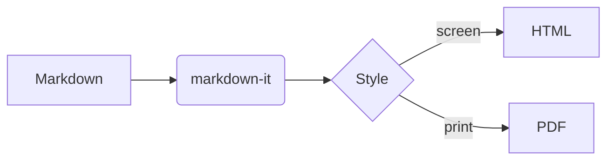

# md2pdf Sample Document

This is a **sample** document with *emphasis*, ~~strikethrough~~, `inline code`, and a [link](https://github.com). Smart quotes: "hello" -- and emoji :rocket: :tada:

## Code

```js
// Syntax highlighted JavaScript
export function greet(name = 'world') {
  const message = `Hello, ${name}!`;
  console.log(message);
  return { message, length: message.length };
}
```

```python
def fib(n: int) -> int:
    """A very long line to check that code wraps rather than getting clipped at the right edge of the page."""
    return n if n < 2 else fib(n - 1) + fib(n - 2)
```

## Table

| Feature        | Supported | Notes                      |
| -------------- | :-------: | -------------------------- |
| Tables         | ✅        | Alignment works            |
| Task lists     | ✅        | Rendered as checkboxes     |
| Footnotes      | ✅        | See below[^1]              |

## Math

Inline math such as $e^{i\pi} + 1 = 0$ and \(\sum_{k=1}^{n} k = \frac{n(n+1)}{2}\) sits in the line, while prices like $5 and $10 stay text.

$$
\int_{-\infty}^{\infty} e^{-x^2} \, dx = \sqrt{\pi}
$$

\[
\mathbf{A} = \begin{pmatrix} a & b \\ c & d \end{pmatrix}, \qquad \det \mathbf{A} = ad - bc
\]

$$f(x) = \sum_{n=0}^{\infty} \frac{f^{(n)}(a)}{n!} (x - a)^n$$ (1)

\begin{aligned}
\nabla \cdot \mathbf{E} &= \frac{\rho}{\varepsilon_0} \\
\nabla \times \mathbf{B} &= \mu_0 \mathbf{J} + \mu_0 \varepsilon_0 \frac{\partial \mathbf{E}}{\partial t}
\end{aligned}

## Diagram

md2pdf.me draws this as a diagram; the CLI prints it as code.



## Lists

- [x] Write the converter
- [x] Style it like GitHub
- [ ] Add more styles later

1. First
2. Second
   - Nested bullet
   - Another

> **Note**
> Blockquotes look like this. Relative images resolve against the Markdown file's folder:


---

Raw <kbd>Cmd</kbd> + <kbd>Shift</kbd> HTML works too.

[^1]: This is the footnote text.
